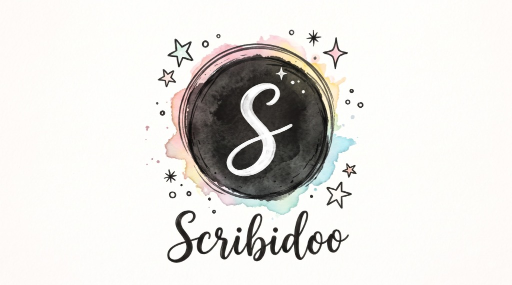
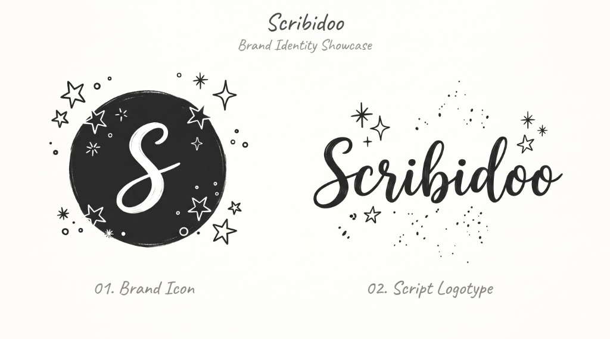

# Scribidoo

A fast, distraction-free handwritten note-taking and sketching app built with Kotlin & Compose Multiplatform. Designed specifically for active digitizer pens (Surface Pen, S-Pen, USI) on Android tablets and Windows Touch PCs.

## Brand Identity Showcase

<p align="center">
  
  
</p>

Scribidoo features a playful, handcrafted brand identity tailored for digital sketchers and note-takers:

- **01. Brand Icon (Monogram)**: Circular black badge with an elegant cursive 'S' surrounded by hand-drawn stars, sparkles, and stardust.
- **02. Script Logotype**: Hand-lettered brush script typography with celestial accents.
- **Watercolor Crest**: Vibrant pastel watercolor halo with the circular monogram and logotype lockup.

---

## Highlights

- **Visual Notebooks Gallery Screen**:
  - Full-featured notebook manager displaying saved documents as visual cards with page count, layout mode badge (`PAGED` vs `INFINITE`), and last modified date.
  - Search and filter bar for instant notebook access.
  - Quick actions per notebook: **Open**, **Rename**, **Duplicate**, and **Delete**.
  - Interactive **Brand Showcase Dialog** displaying official logo assets and app details.
  - Seamless navigation between the gallery and the active canvas workspace.

- **Active Stylus & Touch First**: Low-latency vector inking with quadratic Bézier smoothing and pressure sensitivity.
- **Draggable Palm Rest Guard (Writing Shield)**: Semi-transparent resting guard at the bottom of the screen with a resize handle. Rest your hand comfortably on the glass while writing with a passive stylus or finger!
- **Dedicated Hand / Pan Tool**: Instant one-touch canvas movement without delays or holding.
- **2-Finger Pan & Pinch-Zoom**: Smooth multi-touch navigation across the canvas, plus quick `+`, `-`, and Fit buttons.
- **In-Canvas Stickers & Brand Art**: Insert official Scribidoo brand marks (Watercolor Crest, Brand Icon, Script Logotype, Monogram Badge) directly into notes and drawings.
- **Audio Notes**: Record voice memos directly into your notebook with compact interactive playback pills and non-destructive audio trimming.
- **Media & Paper Clipping**: Proportional resizing with instant 350ms lift & drag for images, text boxes, and audio notes, plus a "Constrain Drawing to Paper" clip toggle.
- **Automatic Auto-Save**: Preserves your notebook notes in real-time (`%LocalAppData%\Scribidoo\autosave.json` on Windows, internal documents storage on Android) so nothing is ever lost on app restart.
- **One-Click Export**: Save high-resolution PNG pages or export complete notes to PDF and JSON formats.
- **Floating Toolbar**: Draggable floating dock switchable between horizontal and compact 2-column vertical modes, with quick hide/unhide support.
- **Canvas Flexibility**: Paged A4 sheets with page navigation, or an infinite dot-grid canvas.
- **Platform-Native App Icons**: Official Brand Icon implemented as Android Adaptive Icon (`ic_launcher`) and multi-resolution Windows Desktop application icon (`icon.ico`).

---

## Architecture

Shared vector canvas core across platforms:

```
├── shared/     # Vector math, Bézier smoothing, eraser engine, models, branding assets & state
├── app/        # Android tablet/phone target (Jetpack Compose, MotionEvent router, Gallery screen)
└── desktop/    # Windows Touch PC target (Compose Multiplatform, Skia, pointerInput, Window icon)
```

---

## Getting Started

### Prerequisites
- JDK 17 or higher
- Android SDK (for `:app`)

### Running on Windows
To launch the desktop app directly:
```bash
./gradlew :desktop:run
```

#### Option A: Windows Installer (.exe / .msi)
Creates an installer that prompts for install location, installs per-user, and automatically adds **Desktop & Start Menu shortcuts** with the official Scribidoo icon:
```bash
# Generate .exe installer:
./gradlew :desktop:packageExe
# Output: desktop/build/compose/binaries/main/exe/Scribidoo-1.0.0.exe

# Or generate .msi installer:
./gradlew :desktop:packageMsi
# Output: desktop/build/compose/binaries/main/msi/Scribidoo-1.0.0.msi
```

#### Option B: Standalone Portable Application (No installation needed)
If you want to copy Scribidoo to a USB drive or laptop and run it immediately without installing any developer tools, JDK, or running an installer wizard:

- **1-Click Build on Dev PC**: Double-click [`build-portable.bat`](build-portable.bat) (or run `./gradlew :desktop:packagePortableZip`).
  - Output files are automatically copied to root `dist/`:
    - `dist/Scribidoo-Portable.zip` (ready to copy via USB or cloud drive)
    - `dist/Scribidoo-Portable/Scribidoo.exe` (unpacked directory)
  - Copy `Scribidoo-Portable.zip` to your laptop, extract it anywhere, and double-click `Scribidoo.exe`. It runs standalone without needing Java or any other dependencies installed!

- **Download directly via GitHub Actions**:
  - Push to GitHub, go to the **Actions** tab, select the latest build, and download `Scribidoo-Portable-Windows` directly on your laptop via your browser.

### Running on Android
Open the project in Android Studio, or build and install via CLI:
```bash
./gradlew :app:installDebug
```
Or build the standalone APK:
```bash
./gradlew :app:assembleDebug
# Output: dist/Scribidoo.apk
```

---

## Gestures & Controls

| Action | Stylus / Touch (Stylus Only Mode) | Stylus / Touch (Touch Draw Mode) | Mouse (Desktop) |
|---|---|---|---|
| **Draw** | Active Pen tip (pressure-sensitive) | Pen tip or 1-finger drag | Left click + drag |
| **Erase** | Pen eraser tail or Eraser tool | Eraser tool | Left click with Eraser tool |
| **Pan Canvas** | 1-finger drag or 2-finger drag | 2-finger drag | Right click + drag or Middle click |
| **Zoom** | 2-finger pinch | 2-finger pinch | Mouse scroll wheel (or Ctrl + Scroll) |
| **Move / Resize Objects** | 350ms long-press & drag handle | 350ms long-press & drag handle | Drag object handle |
| **Palm Rejection** | Complete palm immunity | Adjustable sensitivity | N/A |

---

## License
MIT
